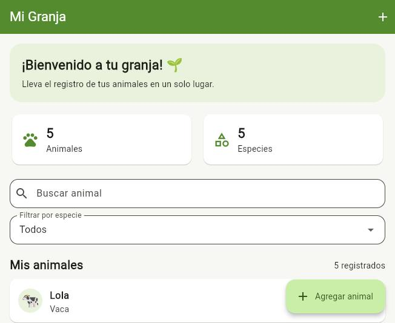
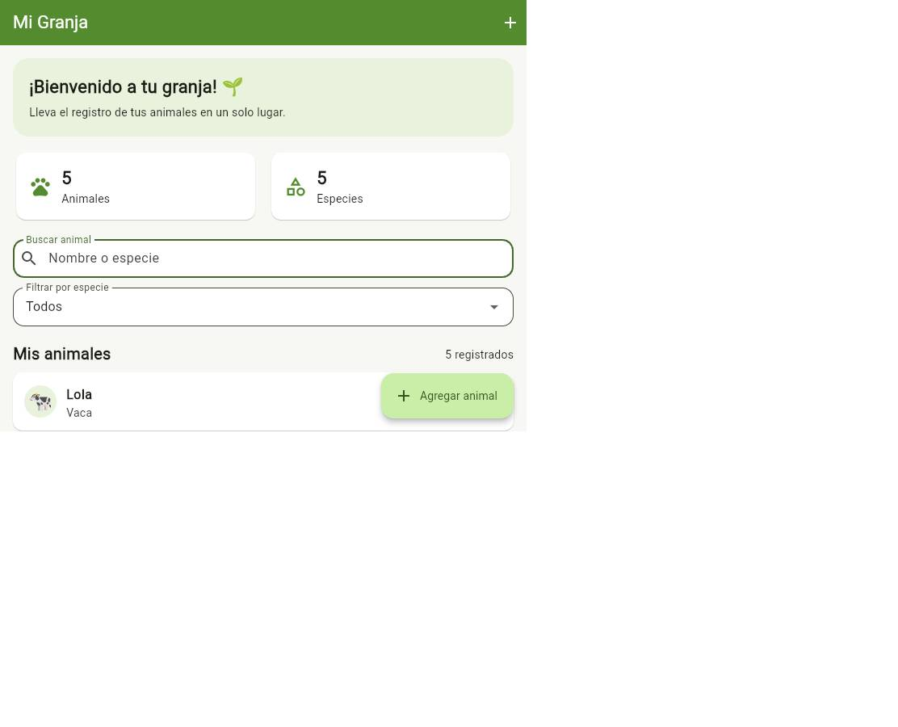
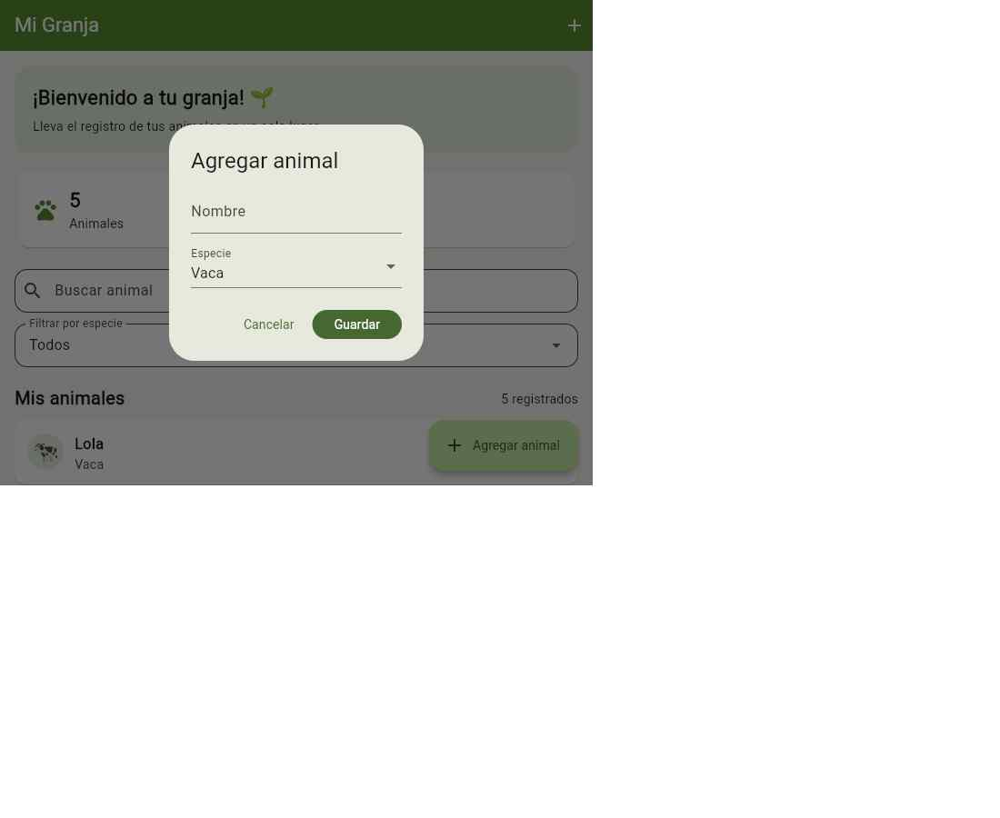
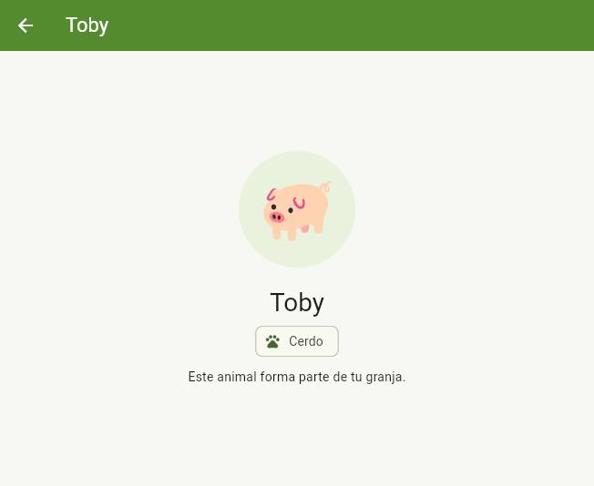
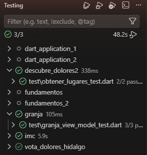

# Mi Granja

Aplicación móvil hecha en Flutter para llevar el registro de los animales de una granja. Arranca con cinco animales de ejemplo, permite buscarlos por nombre o especie, filtrarlos por especie, agregar animales nuevos y abrir una pantalla de detalle de cada uno.

**Autor:** Jonathan Venancio Aguilar Hernandez

## 1. Descripción breve

La pantalla principal muestra un mensaje de bienvenida, dos contadores (animales y especies registradas), un campo de búsqueda, un menú para filtrar por especie y la lista de animales. Búsqueda y filtro se combinan: la lista solo muestra los animales que cumplen ambas condiciones, y si no hay coincidencias aparece el aviso "No encontramos animales con esa búsqueda".

El botón "Agregar animal" abre un formulario con el nombre (obligatorio) y la especie (Vaca, Gallina, Cerdo, Oveja, Caballo u Otro). Al tocar un animal de la lista se abre su detalle, con su emoji, nombre y especie.

Los registros se guardan en memoria: duran mientras la aplicación está abierta y todavía no se conservan al cerrarla.

## 2. Arquitectura

El proyecto está dividido en tres capas. La capa de dominio no depende de Flutter ni de la capa de datos, y las dependencias concretas se arman en un solo lugar, `main.dart`.

| Capa | Carpeta | Responsabilidad |
|------|---------|-----------------|
| Dominio | `lib/domain` | Entidad `Animal`, contrato `AnimalRepository` y casos de uso `ObtenerAnimales` y `AgregarAnimal` |
| Datos | `lib/data` | `AnimalRepositoryMemoria`, que guarda los animales en una lista en memoria |
| Presentación | `lib/presentation` | `GranjaViewModel`, las pantallas y los widgets de apoyo |

**Manejo de estado:** `GranjaViewModel` extiende `ChangeNotifier` y concentra la carga, la búsqueda, el filtro por especie y el alta de animales. Maneja también los estados de carga y de error (con el botón "Reintentar"). La vista se reconstruye cada vez que el ViewModel llama a `notifyListeners()`, sin paquetes externos de estado.

## 3. Estructura del código

```
granja/
├── lib/
│   ├── main.dart                          # Composición de dependencias y tema
│   ├── domain/
│   │   ├── entities/animal.dart
│   │   ├── repositories/animal_repository.dart
│   │   └── usecases/
│   │       ├── obtener_animales.dart
│   │       └── agregar_animal.dart
│   ├── data/
│   │   └── repositories/animal_repository_memoria.dart
│   └── presentation/
│       ├── viewmodels/granja_view_model.dart
│       ├── views/
│       │   ├── granja_page.dart           # Lista, búsqueda, filtro y formulario
│       │   └── detalle_animal_page.dart
│       └── widgets/animal_presentation.dart   # Emoji e ícono por especie
├── test/
│   └── granja_view_model_test.dart
├── capturas/                              # Imágenes usadas en este README
└── pubspec.yaml
```

## 4. Dependencias

La aplicación no usa paquetes externos. Solo necesita el SDK de Flutter; para las pruebas se usa `flutter_test`.

## 5. Cómo ejecutar la app

Requisitos: Flutter 3 o superior (Dart 3.13).

```bash
# 1) Dependencias
flutter pub get

# 2) Ejecutar en emulador, dispositivo físico o navegador
flutter run

# 3) Revisar el código
flutter analyze
```

## 6. Screenshots

### Pantalla principal



### Búsqueda de animales



### Formulario para agregar un animal



### Detalle de un animal



## 7. Pruebas (`flutter test`)

```bash
flutter test
```

Resultado de la ejecución en Visual Studio Code:



Las pruebas están en `test/granja_view_model_test.dart` y usan el repositorio en memoria junto con los casos de uso reales:

| Prueba | Qué comprueba |
|--------|---------------|
| Carga inicial | Se cargan los 5 animales de ejemplo, se cuentan 5 especies, no hay error y `cargando` queda en falso |
| Búsqueda y filtro | Con el filtro "Gallina" y el texto "pep" solo queda Pepa |
| Agregar animal | `agregar` devuelve verdadero y la lista pasa de 5 a 6 animales |
